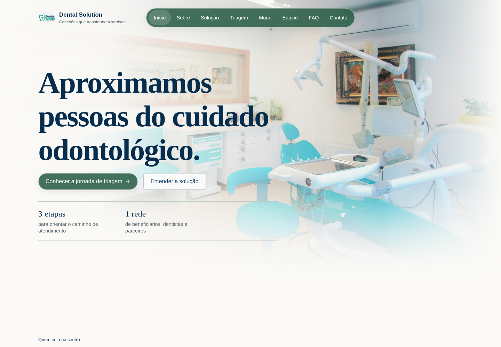
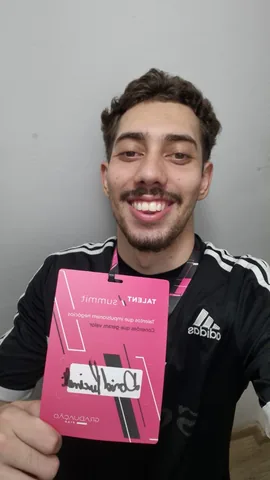
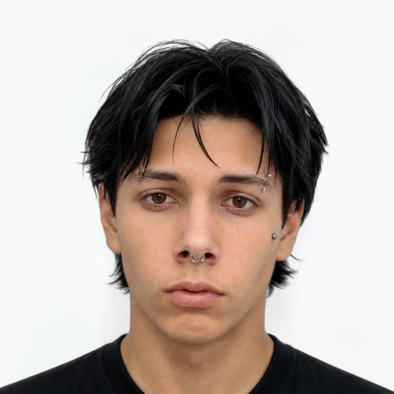

# Dental Solution — Challenge FIAP

O **Dental Solution** aproxima pessoas que buscam orientação em saúde bucal, dentistas voluntários e organizações parceiras. O projeto foi criado para o desafio acadêmico da FIAP inspirado na atuação social da Turma do Bem.

## Sprint 02 — responsividade e interatividade

Esta entrega evolui as páginas da Sprint 01 com HTML, CSS e JavaScript próprios. A identidade verde e azul, as imagens fornecidas e a organização original foram preservadas. A interface se adapta a celular, tablet e desktop.

As fotos de abertura ocupam toda a largura e se dissolvem gradualmente atrás do cabeçalho e no início do conteúdo. A página Equipe também usa o fundo fotográfico de ambiente colaborativo já presente no projeto; os cards têm dimensões consistentes e a última pessoa permanece centralizada. Alguns botões e cartões usam vidro fosco em verde e branco, com contraste preservado. Não são usados emojis nem ícones decorativos genéricos.

Em telas estreitas, os títulos são redimensionados, a triagem apresenta o formulário antes do resumo e a tabela do Mural vira cartões rotulados para evitar corte lateral.



## O que funciona

- Navegação entre Início, Sobre, Solução, Triagem, Mural, Equipe, FAQ e Contato.
- Menu hambúrguer que abre e fecha, anima o ícone e atualiza seu estado acessível; a tecla Escape fecha o menu e devolve o foco ao botão.
- Formulário com validação de nome, e-mail e mensagem por JavaScript, erros próximos aos campos e foco no primeiro problema. Não é usado o atributo HTML `required`.
- Jornada de pré-triagem em três etapas, com avanço e retorno, progresso, resumo das escolhas e resultado educativo.
- Página Sobre com o contexto, a base HTML/CSS/JavaScript e os próximos passos da proposta de cuidado odontológico.
- FAQ com perguntas expansíveis e Mural com indicadores de referência; a tabela do Mural é empilhada em cartões no celular.
- Estados de foco de teclado e ajustes de fontes, espaços e colunas com `@media`.

O escopo desta Sprint é o front-end: o formulário não envia mensagens a um servidor e a jornada não persiste dados, realiza diagnóstico ou agenda atendimento. Os números do Mural são ilustrativos, não resultados auditados da organização.

## Tecnologias

| Tecnologia | Uso |
| --- | --- |
| HTML5 | Conteúdo, estrutura semântica e formulários |
| CSS3 | Identidade visual, layouts, estados e responsividade |
| JavaScript | Eventos do menu, validação e etapas da jornada |
| Git / GitHub | Histórico de versões e colaboração |

Não há framework, template pronto, biblioteca de componentes ou dependência de execução. As ações usam setas vetoriais discretas; os cards usam títulos e tipografia, sem emojis ou ícones decorativos genéricos.

## Como executar

O site é estático. Abra `index.html` no navegador ou, na pasta do projeto, execute um servidor local:

```bash
python3 -m http.server 3000
```

Depois acesse `http://localhost:3000`. Não é necessário instalar pacotes.

Para preparar a versão hospedada em Linux, execute `sh scripts/publicar.sh`. O script gera `dist/`, junta os estilos na mesma ordem dos arquivos originais, copia somente as imagens otimizadas usadas no site e dá ao CSS e ao JavaScript nomes baseados no conteúdo. Isso evita arquivos antigos no cache e cópias desnecessárias das imagens originais ou da captura do README. A pasta `dist/` é gerada e não deve ser editada ou incluída nos commits.

## Organização dos arquivos

```text
dental-solution/
├── index.html
├── paginas/
│   ├── sobre.html
│   ├── solucao.html
│   ├── triagem.html
│   ├── mural.html
│   ├── integrantes.html
│   ├── faq.html
│   └── contato.html
├── css/
│   ├── estilo.css          # entrada dos estilos compartilhados
│   ├── base.css            # cores, fontes, reset e acessibilidade
│   ├── layout.css          # navegação, abertura e títulos
│   ├── componentes.css     # botões, cards e etapas
│   ├── formularios.css     # campos, escolhas, progresso e feedback
│   ├── conteudo.css        # mural, equipe, FAQ e rodapé
│   └── responsivo.css      # adaptações de telas e movimento reduzido
├── js/
│   ├── script.js           # navegação compartilhada
│   ├── contato.js          # validação local do formulário
│   └── triagem.js          # etapas, resumo e orientação educativa
├── img/
│   ├── ...                 # originais preservados no repositório
│   └── web/                # versões leves e captura usada neste README
├── scripts/
│   └── publicar.sh         # prepara a saída estática com arquivos versionados
└── README.md
```

As páginas continuam separadas em HTML, como na base da Sprint 01. Todas carregam `estilo.css` e `script.js`; somente Contato e Triagem carregam o JavaScript específico da página. Os arquivos de CSS são importados localmente na ordem definida em `estilo.css`, com responsividade por último. Não há compilação obrigatória para estudar ou executar o código localmente; o script de publicação apenas prepara cópias para hospedagem.

### Como manter e ampliar

Para criar uma página, mantenha a estrutura semântica, um único `h1`, o cabeçalho e o rodapé das páginas existentes; ajuste `aria-current="page"` no menu. Cada página nova deve ser adicionada aos menus das demais páginas. O HTML duplicado da navegação é intencional neste site estático: não depende de JavaScript para carregar conteúdo essencial.

Use as variáveis de cor em `base.css` e as classes compartilhadas de botões e cards antes de criar estilos. Regras de um componente ficam no arquivo de sua responsabilidade; adaptações ficam em `responsivo.css`. Uma interação nova deve ter seu próprio arquivo em `js/`, carregado com `defer` somente onde for necessário. Evite acrescentar bibliotecas ou serviços fora do escopo da disciplina.

### Pacote de entrega

Após salvar as alterações em um commit, gere o ZIP com `git archive --format=zip --output=dental-solution-sprint2.zip HEAD`. A configuração de exportação exclui metadados do ambiente de trabalho, planejamento interno e cópias originais não usadas pelo site. O pacote mantém os HTMLs, CSSs, scripts, imagens otimizadas e este README. Confira o ZIP, o limite de 50 MB e os links antes de anexá-lo ao Portal do Aluno.

## Equipe — turma 1TDSPB

| Foto | Integrante | RM | Atuação | Perfis |
| --- | --- | ---: | --- | --- |
|  | David Pucinelli da Silva | 576788 | Front-end e estrutura HTML/CSS | [GitHub](https://github.com/DavidPucinelli) · [LinkedIn](https://www.linkedin.com/in/david-pucinelli-b326a9257) |
|  | Enzo Henrique Debiage Câmara Fukimoto | 575754 | Documentação e testes de interface | [GitHub](https://github.com/Enzofukimoto) · [LinkedIn](https://www.linkedin.com/in/enzo-c%C3%A2mara-a691b8318/) |
|  | Marcos Paulo de Souza | 575557 | Revisão de código e supervisão | [GitHub](https://github.com/marcospaulo13) · [LinkedIn](https://www.linkedin.com/in/marcos-souza-50615b180/) |
|  | Luiz Felipe Marques Gomes | 576768 | Revisão de código e versionamento | [GitHub](https://github.com/luiz-felipe-m) · [LinkedIn](https://www.linkedin.com/in/luiz-felipe-marques-gomes-036b90335/) |
|  | Gustavo Almeida Rodrigues | 576939 | Desenvolvimento front-end e direção visual | [GitHub](https://github.com/gtzall) · [LinkedIn](https://www.linkedin.com/in/gustavo-almeida-rodrigues) |

## Repositório e entrega

Repositório da equipe: [Dental-Solution/dental-solution-frontend](https://github.com/Dental-Solution/dental-solution-frontend).

O repositório oficial está público e recebe as alterações da Sprint 02 na branch `main`. Antes da entrega, confirme o link do repositório no Portal do Aluno. Para executar o site localmente, siga as instruções acima.

A rubrica exige repositório público, pelo menos dez commits significativos e contribuição verificável de todos os integrantes. As contribuições de cada pessoa devem ser feitas com a própria identidade; não são criados commits fictícios para simular participação.

## Imagens, ícones e referências

No repositório, as imagens originais da Sprint 01 foram mantidas em `img/`; o site e o ZIP utilizam as versões leves de `img/web/`. O retrato de Gustavo e a fotografia do sorriso foram fornecidos para o projeto. A captura da Home foi feita a partir da interface implementada.

Galerias indicadas pela equipe — como Mobbin, UIverse, Supahero, Wensity e outras — serviram como referência de composição e interação. Não foram usados templates ou componentes externos para substituir o HTML, CSS e JavaScript exigidos na disciplina.

## Contato

Para falar com os autores, utilize os perfis GitHub e LinkedIn da tabela acima. O responsável pelos ajustes de front-end é [Gustavo Almeida Rodrigues](https://www.linkedin.com/in/gustavo-almeida-rodrigues), também disponível no [GitHub gtzall](https://github.com/gtzall). A página de contato do site é uma interface de validação local e não encaminha mensagens.
