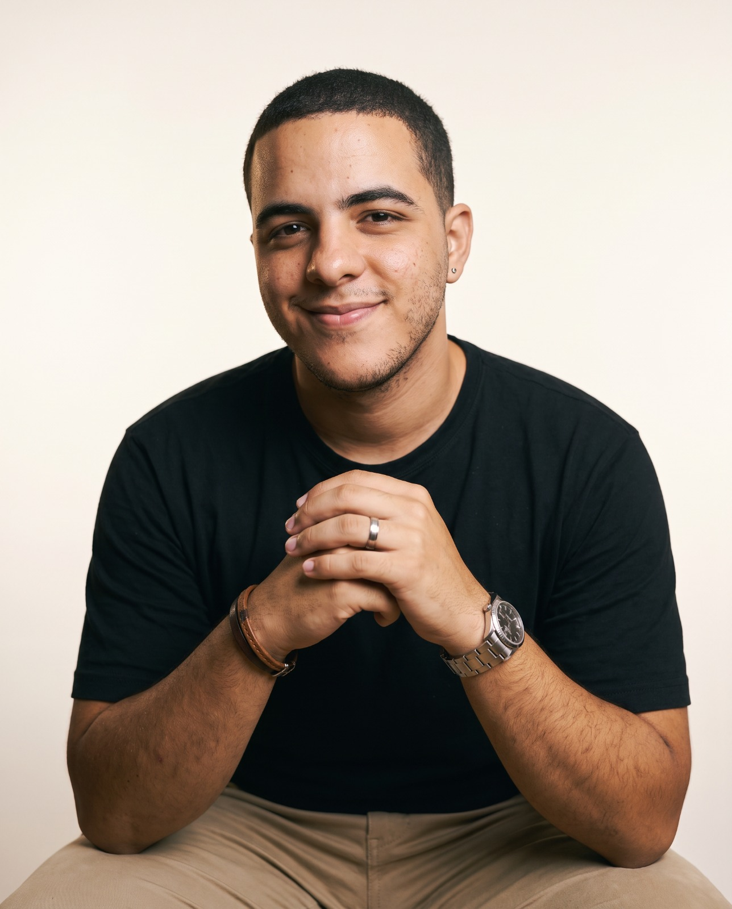
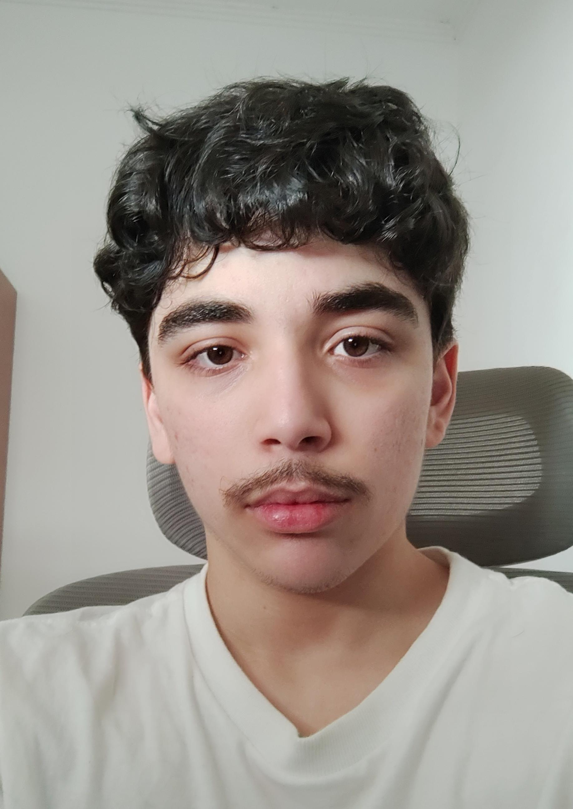
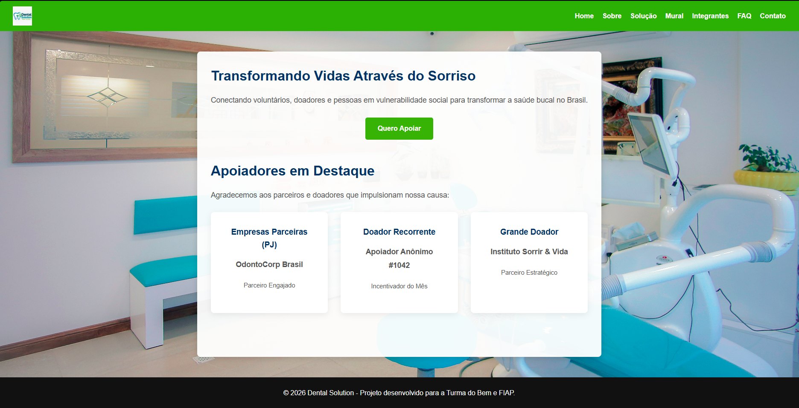
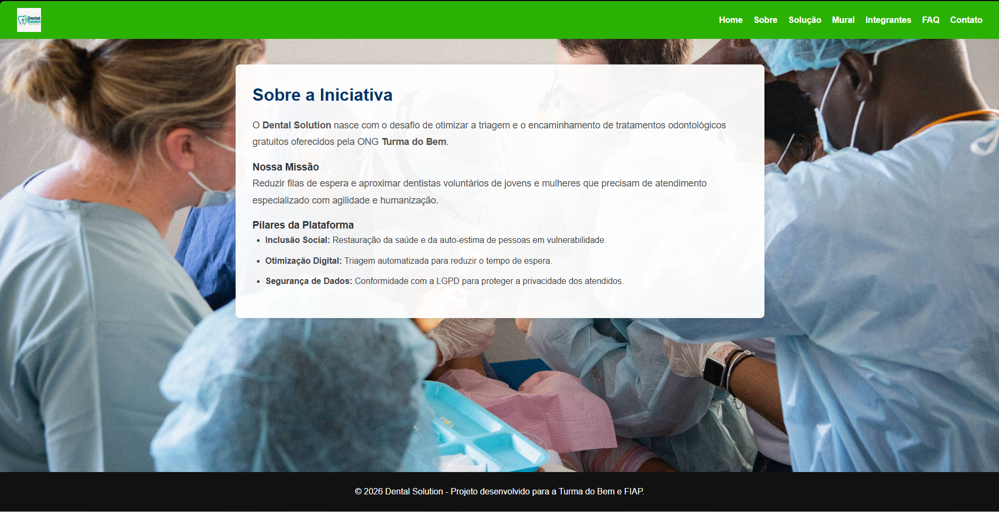

# 🦷 Dental Solution - Challenge Turma do Bem

## 📌 Descrição do Projeto
O **Dental Solution** é uma solução web desenvolvida para apoiar e otimizar a triagem, o engajamento e o acompanhamento dos atendimentos prestados pela ONG **Turma do Bem**. O sistema conecta jovens e mulheres beneficiárias a dentistas voluntários, promovendo gestão eficiente, transparência e impacto social.

---

## 👥 Integrantes do Grupo
| Nome Completo | RM | Turma | Responsabilidade / Atuação | LinkedIn | GitHub |
| :--- | :---: | :---: | :--- | :---: | :---: |
|  David Pucinelli da Silva | RM576788 | 1TDSPB | Desenvolvimento Front-End & Estrutura HTML/CSS | [LinkedIn](https://www.linkedin.com/in/david-pucinelli-b326a9257/) | [GitHub](https://github.com/DavidPucinelli) |
|  Enzo Henrique Debiage Câmara Fukimoto | RM575754 | 1TDSPB | Documentação Técnica & Testes de Interface | [LinkedIn](https://www.linkedin.com/in/enzo-câmara-a691b8318/) | [GitHub](https://github.com/Enzofukimoto) |
|  Marcos Paulo de Souza | RM575557 | 1TDSPB | Revisão de Código e Supervisão | [LinkedIn](https://www.linkedin.com/in/marcos-souza-50615b180/) | [GitHub](https://github.com/MarcosPaulo13) |
|  Luiz Felipe Marques Gomes | RM576768 | 1TDSPB | Revisão de Código & Controle de Versionamento | [LinkedIn](https://www.linkedin.com/in/luiz-felipe-marques-gomes-036b90335/) | [GitHub](https://github.com/luizfelipe-m) |
---

## 💻 Tecnologias Utilizadas
* **HTML5**: Estruturação semântica sem o uso de scripts (JS).
* **CSS3**: Estilização externa padronizada e voltada para layouts Desktop (≥992px).
* **Git & GitHub**: Controle de versão e colaboração em equipe via *Conventional Commits*.

---
## 📸 Demonstração do Sistema




---
## ✉️ Contato e Suporte

Caso tenha dúvidas, sugestões ou precise de suporte relacionado a este projeto, entre em contato com os desenvolvedores:

* **David Pucinelli da Silva** - [LinkedIn](https://www.linkedin.com/in/david-pucinelli-b326a9257/) | [GitHub](https://github.com/DavidPucinelli)
* **Enzo Henrique Debiage Câmara Fukimoto** - [LinkedIn](https://www.linkedin.com/in/enzo-câmara-a691b8318/) | [GitHub](https://github.com/Enzofukimoto)
* **Marcos Paulo de Souza** - [LinkedIn](https://www.linkedin.com/in/marcos-souza-50615b180/) | [GitHub](https://github.com/MarcosPaulo13)
* **Luiz Felipe Marques Gomes** - [LinkedIn](https://www.linkedin.com/in/luiz-felipe-marques-gomes-036b90335/) | [GitHub](https://github.com/luizfelipe-m)

---
*Projeto desenvolvido para apoio e otimização dos atendimentos da ONG Turma do Bem.*

---


---
## 📁 Estrutura do Repositório
```text
dental-solution/
├── css/
│   └── estilo.css
├── img/
│   └── banner.jpg
├── paginas/
│   ├── contato.html
│   ├── faq.html
│   ├── integrantes.html
│   ├── mural.html
│   ├── sobre.html
│   └── solucao.html
├── index.html
└── README.md


