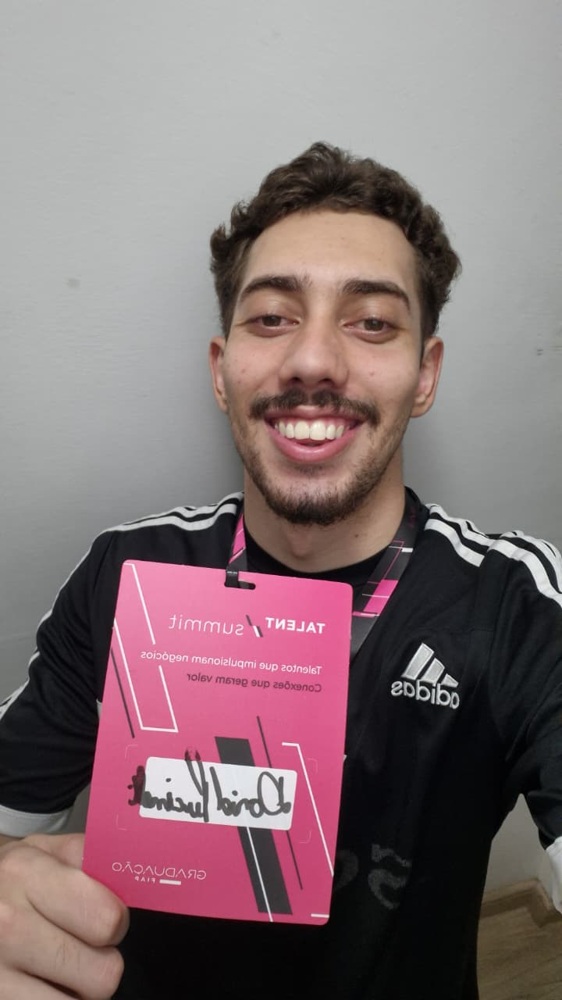

# 🦷 Dental Solution - Challenge Turma do Bem

## 📌 Descrição do Projeto
O **Dental Solution** é uma solução web desenvolvida para apoiar e otimizar a triagem, o engajamento e o acompanhamento dos atendimentos prestados pela ONG **Turma do Bem**. O sistema conecta jovens e mulheres beneficiárias a dentistas voluntários, promovendo gestão eficiente, transparência e impacto social.

---

## 👥 Integrantes do Grupo
| Nome Completo | RM | Responsabilidade / Atuação |
| :--- | :--- | :--- |
|  David Pucinelli da Silva | RM576788 | Desenvolvimento Front-End & Estrutura HTML/CSS |
|  Enzo Henrique Debiage Câmara Fukimoto | RM575754 | Documentação Técnica & Testes de Interface |
|  Marcos Paulo de Souza | RM575557 | Revisão de Código e Supervisão |
|  Luiz Felipe Marques Gomes | RM576768 | Revisão de Código & Controle de Versionamento |

---

## 💻 Tecnologias Utilizadas
* **HTML5**: Estruturação semântica sem o uso de scripts (JS).
* **CSS3**: Estilização externa padronizada e voltada para layouts Desktop (≥992px).
* **Git & GitHub**: Controle de versão e colaboração em equipe via *Conventional Commits*.

---

## 📁 Estrutura do Repositório
```text
dental-solution/
├── css/
│   └── estilo.css
├── img/
│   └── banner.jpg
├── paginas/
│   ├── contato.html
│   ├── faq.html
│   ├── integrantes.html
│   ├── mural.html
│   ├── sobre.html
│   └── solucao.html
├── index.html
└── README.md
